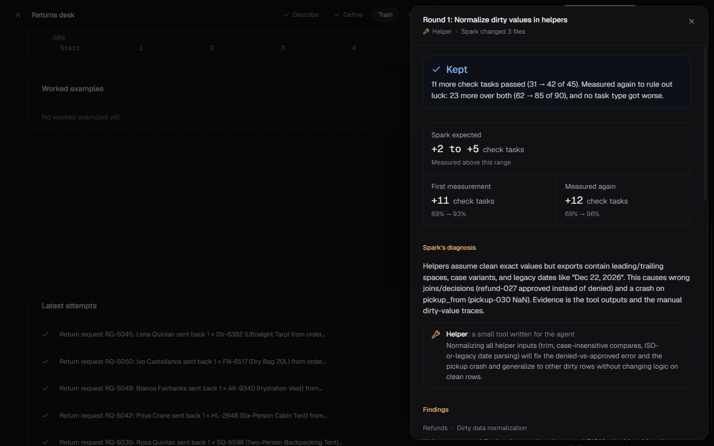
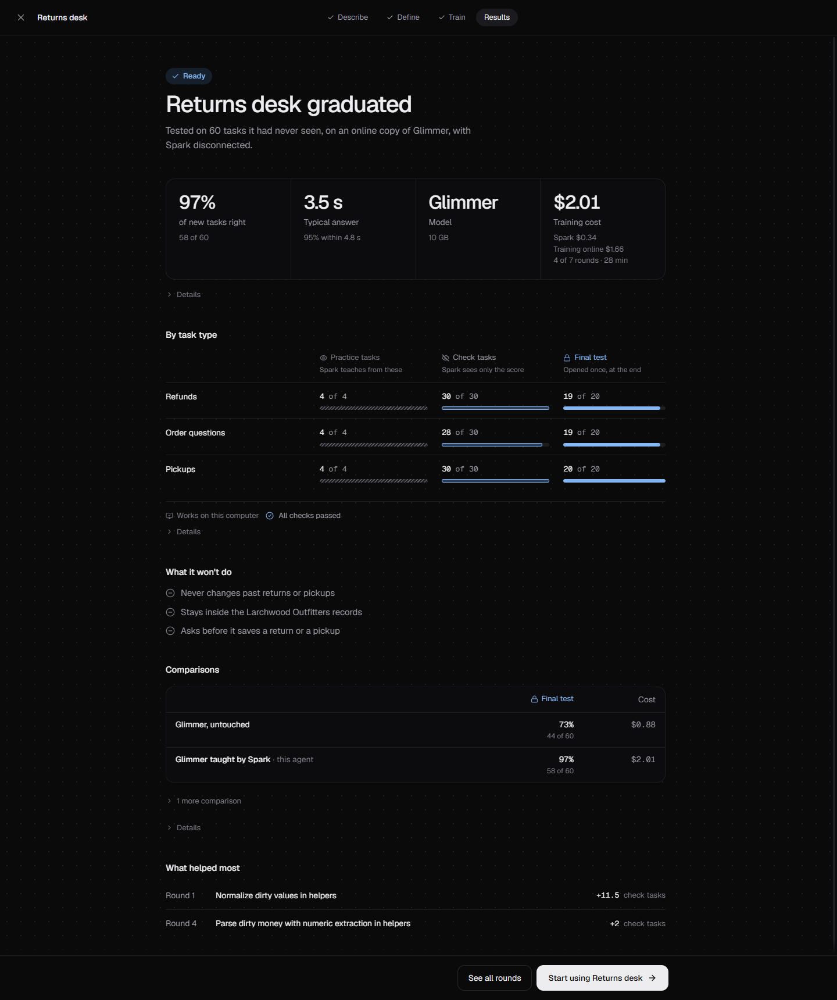

# Architect

Architect builds an AI assistant for one specific job and makes it run on your own computer.

You describe the job and give it the files it works from. A large AI model then acts as a teacher. It watches a smaller model, one that fits on your PC, try the job. When the small model gets something wrong, the teacher finds the step where it went wrong, shows the right way to do it from that point, and changes the small model's instructions and tools so it doesn't make the same mistake again. A change stays only if the small model actually does better on check requests the teacher learns nothing from. When the small model passes a final test on its own, it becomes your agent.

You then work with the agent inside Architect. It reads and edits your files, asks before it changes anything unless you tell it not to, and never sends your data anywhere: it only talks to the model running on your computer.

It's meant for repetitive work on data you'd rather not send to a cloud model every time, such as a small shop's returns desk, a back office or an internal tool.

By default the teacher is Muse Spark 1.3, through Meta's API, and the small model is Muse Glimmer, a 30-billion-parameter open model that runs on your PC through Ollama. You can swap either one.

<picture>
  <source media="(prefers-color-scheme: light)" srcset="docs/comparisons/screens/returns-desk-2-round-1-light.png">
  
</picture>

## Install

Download the installer for your computer from the [latest release](https://github.com/echoo19/architect/releases/latest).

**Windows.** Run `Architect-Setup-<version>.exe`. It installs for your user account and opens Architect when it finishes. The installer isn't signed yet, so Windows may say it protected your PC: choose More info, then Run anyway.

**macOS.** Open the disk image for your Mac (`arm64` for Apple silicon, `x64` for Intel) and drag Architect into Applications. The app isn't signed yet, so macOS blocks the first launch: right-click Architect, choose Open, then Open again. On macOS 15 and later, go to System Settings > Privacy & Security and choose Open Anyway.

Architect needs [Ollama](https://ollama.com) on the same computer. The first screens check for it, download the small model and connect the teacher:

- Muse Glimmer comes in two sizes. The recommended one is a 17 GB download and needs about 20 GB of graphics memory. The smaller one, made for 12 GB graphics cards, is a 14 GB download. Architect suggests the one that fits your card.
- The teacher needs an API key from Meta, or from one of the other services under [Models](#models).

To see a finished agent before you train one, choose **Try a ready-made agent** on the new-agent screen. It installs the returns desk agent from the results below, with its shop's records, and you can chat with it right away.

## What you do in Architect

1. **Describe the job.** Say what the agent should do and attach the files it works from. The teacher asks a few questions, then drafts the job with you: what the agent does and doesn't do, example requests with their right answers, how an answer is checked, the score it must reach, and a spending limit.
2. **Watch it learn.** The small model works through practice requests. A fixed checker marks every answer right or wrong; no AI decides whether an answer passes. After each round the teacher reads the attempts that failed, names the step where the small model went wrong, and makes one change: an instruction, a step-by-step procedure, a small tool, or a worked example. Architect tries the change on a separate set of check requests the teacher learns nothing from, and keeps it only if the small model does better there, twice in a row. You can open any attempt and step through what the model did, and see why each change was kept or undone.
3. **Final test.** When the small model reaches its target, or the budget runs out, the teacher is disconnected and the small model takes a final test it has never seen, once. The results page shows how it did on each kind of request, how fast it answers, what training cost, and which changes helped most.
4. **Use the agent.** Chat with it in the workspace. It reads and searches your files and can run small programs over them in a sealed sandbox. By default, every change it wants to make to a file waits for your OK, with the exact rows it would add or change. Requests it wasn't trained for are refused, with the reason.
5. **Correct it.** If an answer is wrong, flag it and say what it should have done. Nothing goes to the teacher until you confirm, and then only that one exchange. The teacher turns your correction into a lesson. You can save a lesson as a new version right away, or queue several and let Improve agent train a new version. The version you're using keeps answering until you switch, and you can switch back at any time.
6. **Share it.** Export the agent as one `.architect.zip` file, or publish it to Hugging Face, privately by default. Someone who installs it chooses their own folders and decides what it may touch, and Architect checks that it runs on their computer before they use it. Your chats, your data and your keys stay out of the file unless you choose to include something.

There is also a command line, `architect`, that lists, installs, runs, checks, exports and publishes agents with the same rules as the app. See [docs/CLI.md](docs/CLI.md).

## What Architect guarantees

These hold everywhere, and the tests check each one:

- The final test is locked away. Only the part of Architect that gives the test can open it, and only after the teacher is disconnected. Everything sent to the teacher is checked for test material first.
- The teacher can change only the agent's instructions, procedures, tools and examples. It can't change how answers are checked, the practice or test requests, your data, or what the agent is allowed to touch.
- Tools the teacher writes run in a sealed sandbox in a separate process: no internet, no clock, no randomness, and read-only access to the files the job names.
- Spending limits are hard limits. A call to the teacher that could go over the limit doesn't start.
- The finished agent can reach nothing but the model on your computer.

## Models

The teacher can be Muse Spark 1.3 with a key from Meta; a model from OpenAI, Anthropic or Google Gemini with that company's key; any model on OpenRouter, where you can sign in instead of pasting a key; a model from any service that speaks the OpenAI API, such as Groq, Together or DeepInfra, given its address and key; or a model already running on your computer in Ollama or LM Studio, which needs no key and costs nothing.

Keys are encrypted on your computer and only ever sent to the service they belong to.

The small model can be any model in Ollama, or any model served on your computer by something that speaks the OpenAI API, such as LM Studio or llama.cpp. Architect reads how much graphics memory you have and shows which models fit. To train faster, the small model can practice on a copy served online by OpenRouter or a similar service; the final test and every chat with the finished agent still run on your computer.

Architect can also train the small model's own weights (a LoRA adapter) when instructions and tools alone aren't enough. It sends the training to a rented GPU on Hugging Face, brings the result back, checks it, and runs it on your computer through llama.cpp. Each step is built and tested against stand-ins, but no real training run has gone through yet, so the agents here are taught through instructions, procedures, tools and examples only.

Prices, addresses and what was tested are in [docs/MODELS.md](docs/MODELS.md).

## Results

Every result here comes from a made-up business with a fixed checker: a program, not a model, decides whether each answer is right. Each comparison keeps back a final test of 60 requests that no teaching ever sees, and each version of Glimmer takes it once. To save time, Glimmer ran online for these comparisons, the full model served through OpenRouter. The agents then run on your computer with a smaller build, which these numbers don't cover except where noted. The full reports are in [docs/comparisons](docs/comparisons).

### Returns desk

The returns counter of an outdoor-gear shop: deciding return requests and working out refunds, answering questions about orders, and booking carrier pickups.

| Out of 60 final-test requests | Comparison 1 | Comparison 2 |
| --- | --- | --- |
| Glimmer on its own | 43 | 44 |
| Glimmer with Spark's one-shot setup | 47 | 38 |
| Glimmer after Spark's teaching | 45, after 2 rounds | 58, after 4 rounds |
| Spark doing the job itself | 60 | not run |

Comparison 1 ran on the returns desk that ships with Architect. Request by request, teaching fixed 11 of Glimmer's misses and broke 9 of its right answers, so it showed no clear gain in accuracy. It did make Glimmer quicker: the typical answer took 7.0 s instead of 17.7 s, and the slowest one in twenty took 20.7 s instead of 70.5 s. Its teaching had been held to two rounds and used $0.17 of Spark.

Comparison 2 was planned after seeing comparison 1, and [the plan](docs/comparisons/returns-desk-2-plan.md) was published before it ran: a new shop from the same generator, teaching with the job's own budget of up to 8 rounds and $5 of Spark, and a gain counted only if the 95% interval for teaching against Glimmer on its own is above zero.

Teaching reached the job's 95% target on the check requests after four rounds and stopped there. It kept two changes, both to Glimmer's tools, so they read the shop's messy records correctly: amounts written with currency signs and commas, and values wrapped in quotes. On the final test Glimmer then passed 58 of 60. Request by request, teaching fixed 15 of Glimmer's misses and broke 1 of its right answers: 23 points better, with a 95% interval of 11 to 36 points, so by the plan's own rule the gain is real. It also made answers much faster: 3.5 s for a typical one and 4.8 s for the slowest one in twenty, against 17.7 s and 42.7 s.

Spark's one-shot setup scored 38, lower than Glimmer on its own, though not by a clear margin. The gain came from the rounds: teaching started from that same setup and beat it on 20 requests while losing none. The whole comparison cost $0.42 of Spark and $3.38 of online Glimmer. The agent it made is the one under **Try a ready-made agent**.

<picture>
  <source media="(prefers-color-scheme: light)" srcset="docs/comparisons/screens/returns-desk-2-results-light.png">
  
</picture>

### Service desk, with the first version of the tools

Before Glimmer worked through a coding agent's tools (read, search, edit and a sandbox), it used simpler table tools. On the sample job, the back office of a home-services company that prices finished jobs into invoices, answers questions about overdue balances and books visits, Glimmer on its own passed 45 of 60. With the setup Spark wrote once, before seeing Glimmer try anything, it passed all 60, for about seven cents of Spark. Watching Glimmer added nothing there, because Spark's first draft already passed every check request. The same agent, run again on a PC with an RTX 4070 Ti and the 4-bit Glimmer, with no network, passed all 60 too, at about two minutes an answer.

### What this shows, and what it doesn't

- Spark's teaching can make a 30B model that fits on a PC good at a job it used to get wrong a quarter of the time. On the second returns desk, Glimmer went from 44 to 58 of 60 on requests the teaching never saw, and answered about five times faster, for 42 cents of Spark.
- What worked there came from watching Glimmer fail: the changes that stayed were written from its failed attempts, and the setup Spark wrote without watching did no better than nothing.
- With teaching held to two rounds, the first comparison showed no gain. The second had more rounds and a different shop, so it can't say which of the two made the difference.
- Not shown: other kinds of jobs; these agents on the 2-bit build that runs on a 12 GB card, which hasn't taken the final test; and training the model's own weights, which is built but has never run for real.

## Status

Built from an empty repository between Oct 27 and Nov 4, 2026. [docs/PROGRESS.md](docs/PROGRESS.md) says where things stand, and [docs/EXPANSION.md](docs/EXPANSION.md) lists each requirement with its evidence.

## Docs

- [docs/CLI.md](docs/CLI.md): the `architect` command
- [docs/MODELS.md](docs/MODELS.md): models, addresses, prices
- [docs/comparisons](docs/comparisons): the comparisons, their plans and full reports
- [docs/ARCHITECTURE.md](docs/ARCHITECTURE.md): how the parts fit together, for developers
- [docs/DECISIONS.md](docs/DECISIONS.md): design decisions and why
- [SPEC.md](SPEC.md) and [docs/SPEC_EXPANSION.md](docs/SPEC_EXPANSION.md): what Architect was built to do

## Related work

Architect sits near several lines of work. What differs in each is which model writes the improvements, what it may change, and what has to happen before the result is trusted.

DSPy tunes the instructions and examples of a pipeline of model calls against a score on training data, and can use a stronger model to produce examples. TextGrad uses a model's written feedback to revise prompts. Architect's teacher also writes feedback-driven changes, but from the small model's own failed attempts, one change at a time with a predicted effect, and it can add procedures, tools and worked examples as well as instructions.

Voyager, an agent that plays Minecraft, builds a library of skills as code and reuses them, written by the same model that uses them. In Architect a strong model writes skills and tools for a weaker one, then leaves.

Reflexion has an agent reflect on its own failures and keep those notes for later attempts. DAgger-style training corrects a learner at the states it actually reaches; Architect's replay of a failed attempt from the step where it went wrong follows the same idea, and doesn't claim it as new.

AIDE and MLE-bench keep only what scores well on a validation set and report a final number from a test the optimizer never saw. Architect borrows that discipline.

## Built during the Meta Global AI Developer Hackathon

Architect was built from an empty repository during the Meta Global AI Developer Hackathon (Oct 27 to Nov 4, 2026). The idea predates the event; the code does not. The commit history shows what was built when, and [docs/HACKATHON.md](docs/HACKATHON.md) has the details.

## How it was built

Written by Jake Kang with AI coding agents: Claude Code did most of the implementation under Jake's direction, with GPT-6 Astra giving second opinions on design decisions.

## Licence

MIT
