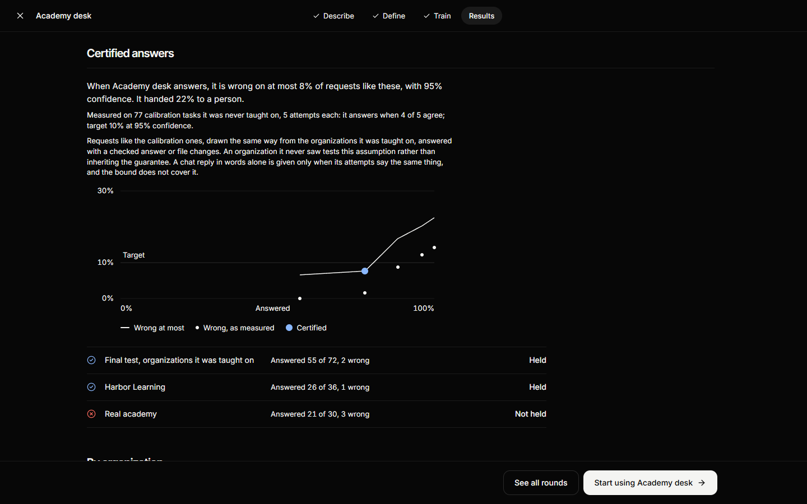
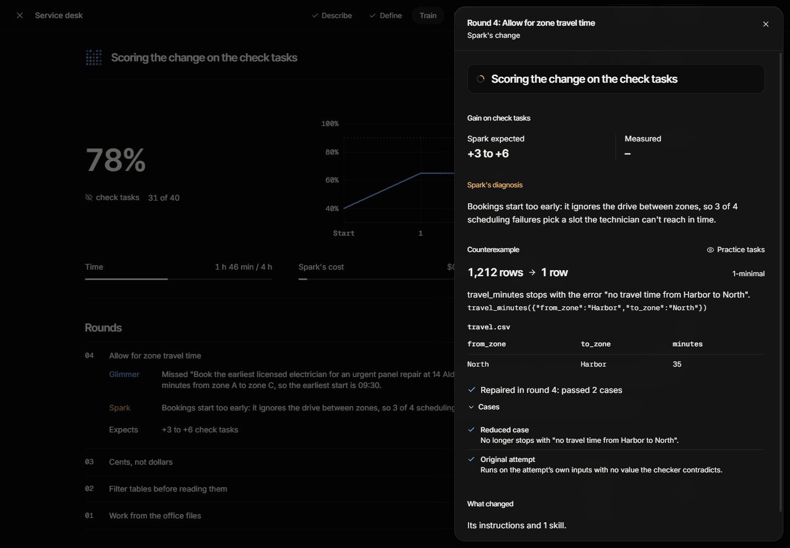
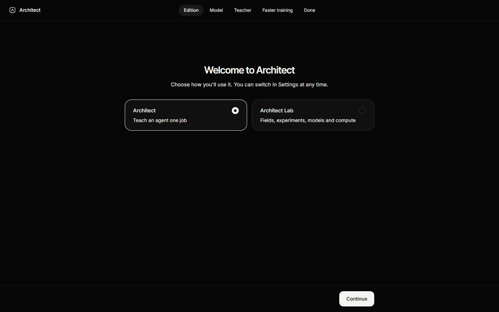
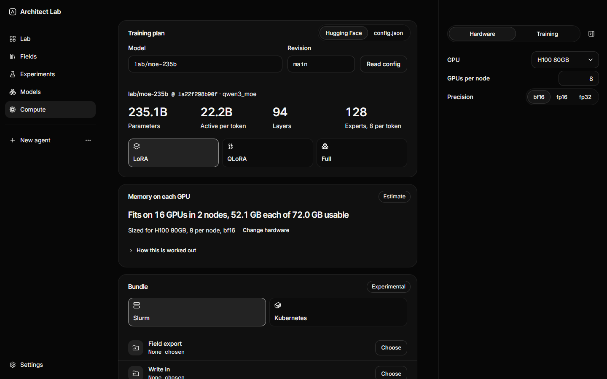

# Architect

**The training system for your own AI.**

A large model teaches a small one by rewriting its instructions and tools. Every change is tested on work neither model has seen, and Architect certifies when the result can be trusted. For a whole field, "unseen" means organizations the small model was never taught on, one of them real. [See it on the website](https://echoo19.github.io/architect/).

## What you can make with it

The specialists are what the system makes. They are examples, not the product.

- **Returns desk** works an outdoor-gear shop's returns: it decides return requests, answers questions about orders and books carrier pickups. It asks before it changes a record.
- **Service desk** does a home-services company's end-of-day office work: it prices finished jobs into invoices, works out overdue balances and books technicians.
- **Academy desk** helps the staff of test-prep academies: it diagnoses a missed practice question, sets practice in the academy's records and flags the student for their tutor. It is the main example below.
- **A pricing desk** that a large model drafted from a repair shop's files, after the owner confirmed the pricing rule it made from the shop's policy.
- **Sweep desk and Assay desk**, for research groups running training sweeps and for screening labs, are the science set, coming soon.

Academy desk answers from each academy's own files: its topics, question bank, lessons, the student's history and its tutoring policy. Two academies with different policies get different correct actions from the same Academy desk.

## How it works

1. **Study.** Muse Spark, a large model, reads the organization's files and writes a short brief: the skills, the rules it found, and what is unclear. You confirm it.
2. **Teach.** Spark teaches Muse Glimmer, a small model that fits on a PC, on some of the organizations. When Glimmer gets something wrong, Spark finds the step where it went wrong and changes Glimmer's instructions and tools. A change stays only if Glimmer then does better on check tasks Spark never sees.
3. **Seal.** Other organizations are kept away from both models, so nothing is learned from them.
4. **Qualify.** A final test runs once, after everything is frozen. A program scores it for each skill at each organization, and never scores wording.

The result is a specialist that works on an organization's files, asks before it changes one, and talks to nothing but the model on your machine. The same steps work on a single job, like the returns desk below.

## Certified answers

A specialist should know when not to answer. After qualification, Architect can state a certificate that a buyer can read:

> When Academy desk answers, it is wrong on at most 8% of requests like these, with 95% confidence. It handed 22% to staff.

The 8% and 22% show the form of the sentence. They are not a measurement of Academy desk.

How it is computed:

1. **A sealed calibration set.** It is drawn from the taught organizations, kept apart from every other split, and the teacher never sees it. It opens once, after the specialist is frozen.
2. **Agreement.** Academy desk attempts each calibration request k times (five by default). The share of attempts that agree with the most common answer is its agreement. When agreement reaches a threshold, Academy desk answers. Below it, Academy desk says it isn't sure and hands the request to a person.
3. **A bound.** For each threshold, the error rate among the requests Academy desk answered gets an exact one-sided Clopper-Pearson upper bound. Thresholds are tried from strictest to loosest, and the loosest one whose bound stays under the target is chosen. If none qualifies, no certificate is issued, and the report says why.
4. **A check on organizations it never saw.** The same frozen threshold runs on the sealed test and on each unseen organization, and the report shows whether the bound held there. The guarantee assumes requests like the calibration ones, so an unseen organization tests that assumption.

A small calibration set gives a wide bound, and the report shows it wide.

## Counterexample-guided repair

When a helper that Spark wrote gives a wrong result on practice data, Architect shrinks the failing case until little is left. On a generated academy's practice data, a question lookup that crashed on tests laid out as "Full" went from 2,312 rows to 4. Spark repairs the helper against that small case, the repair must also pass the original case and every earlier one, and the case stays in the field's regression suite so a later change can't break the helper again.

What this shows is a reproducible defect in a helper, not why the model reasoned as it did.

Both are built and tested, with stand-in models and on the academy's practice data. The screenshots above use stand-in data too. A certificate for Academy desk from a live run has not been measured yet, because it needs five attempts per task. Neither idea is new. We build on conformal risk control ([arXiv 2208.02814](https://arxiv.org/abs/2208.02814)), Learn-then-Test ([arXiv 2110.01052](https://arxiv.org/abs/2110.01052)), conformal abstention ([arXiv 2405.01563](https://arxiv.org/abs/2405.01563)) and delta debugging (Zeller and Hildebrandt, 2002). What is new here is the pipeline in a product: a deterministic checker, sealed sets the teacher never saw, and a check on organizations it never saw. The plan is [docs/CERTIFY.md](docs/CERTIFY.md).

## Two editions

Architect is one app in two editions. You choose one on the first screen and can switch in Settings. One download includes both.

- **Architect** teaches an agent one job. You describe the job, Spark teaches Glimmer, a sealed test checks it, and the agent runs offline. The returns desk below is this edition.
- **Architect Lab** is a workbench for founders and researchers who build models for a field. It adds fields, with the organizations a model is taught on and the ones it never sees; experiments that are preregistered before they run; a registry of every model version with its scores; and compute plans for training.

## Results

### Academy desk, tested across academies

Academy desk is Glimmer with the instructions and tools Spark built for it. Spark studied three generated academies and taught Glimmer on them. The sealed test had 120 tasks: 48 held out from those three academies, 48 from Harborview Prep, a fourth generated academy with numbers in its policy that no taught academy has, and 24 from a real academy, anonymized, whose records are not published. Neither model had seen the last two. On the real academy only three skills could be checked, because its records have no question text.

| Passed, out of tasks | Glimmer on a blank setup | Spark's one-shot setup | Academy desk |
| --- | --- | --- | --- |
| Taught academies (48) | 21 | 22 | 44 |
| Harborview Prep, unseen (48) | 24 | 22 | 43 |
| Real academy, unseen (24) | 9 | 11 | 12 |

- On Harborview Prep, Academy desk passed 43 of 48 and a blank setup 24. Task by task, Academy desk won 20 and lost 1, a difference of 39.6 points with a 95% interval of 22.9 to 53.7. A gain is shown on that one academy.
- On the real academy, Academy desk passed 12 of 24 and a blank setup 9. The difference is 12.5 points with an interval of -17.9 to 40.2. No gain is shown there.
- By skill on the real academy, assign went from 0 of 8 to 7 of 8, history fell from 5 to 3 and diagnose from 4 to 2. Eight tasks per skill is too few to call these differences.
- The misses came from tools built on the generated academies. The question lookup tool found a test by its section, and 11 of the real academy's 19 practice tests list the section as "Full". The history helper counted answers written another way as wrong, and the agent's date did not match the date in the requests. We found this by replaying Academy desk's tools against the real academy's files after the test was retired. The date cause fits the records and is not confirmed.
- The one-shot setup showed no gain over a blank setup in any group.
- Teaching took three rounds, about 15 minutes. Two changes were kept and one was reverted. The run cost about $0.58 of Spark and $4.26 of hosted Glimmer.

Limits: the numbers come from full-precision Glimmer hosted through OpenRouter, under one seed, and the build that runs on your computer was measured afterward, as the next section shows. The real academy gave 24 tasks from 16 students, and its policy was drafted for this test and awaits the academy's confirmation. A script confirmed the study, not a person. The settings differ by arm: the blank setup ran at temperature 1 with 16 turns, and the other two at temperature 0 with 30 turns. The full report is [docs/comparisons/academy-desk-1.md](docs/comparisons/academy-desk-1.md).

### Academy desk on this computer

Academy desk was then frozen as it was and took the same 120 tasks again on the 2-bit build of Glimmer that runs on an RTX 4070 Ti with 12 GB, through Ollama. Nothing was taught or tuned for this check, and the test had already been opened.

| Passed, out of tasks | Academy desk, local | Academy desk, hosted |
| --- | --- | --- |
| Taught academies (48) | 45 | 44 |
| Harborview Prep, unseen (48) | 41 | 43 |
| Real academy, unseen (24) | 17 | 12 |
| All (120) | 103 | 99 |

- Over all 120 tasks the difference is +3.3 points with a 95% interval of -4.3 to +11.0. No group shows a difference.
- A typical task took 38 seconds locally and 9 hosted, about four times as long. Eleven tasks hit the step limit locally and seven hosted.
- The untaught Glimmer did not finish on the Real academy locally: that run stopped after 2 of 24 tasks when the system ran low on memory. So this does not show how the build does without Academy desk's setup. It is one seed. The report is [docs/comparisons/academy-desk-1-local.md](docs/comparisons/academy-desk-1-local.md).

A second field run is prepared and has not been run yet.

### The returns desk, one job

<picture>
  <source media="(prefers-color-scheme: light)" srcset="docs/comparisons/screens/returns-desk-2-train-light.png">
  
</picture>

This run came before Academy desk's. It is the simpler case: one job and one business's files.

<picture>
  <source media="(prefers-color-scheme: light)" srcset="docs/comparisons/results-light.svg">
  
</picture>

- On a new returns desk, teaching took Glimmer from 44 to 58 of 60 on requests it had never seen. Request by request it fixed 15 and broke 1, so it's 23 points better, with a 95% interval of 11 to 36. The plan was [published before the run](docs/comparisons/returns-desk-2-plan.md).
- Its typical answer dropped from 17.7 seconds to 3.5.
- The teaching cost 42 cents of Spark.
- A run before it, with teaching held to two rounds, showed no clear gain.

Those numbers were measured on full-precision Glimmer, hosted through OpenRouter. The gain came from changes to Glimmer's instructions and tools; no weights were trained. The smaller 4-bit build that runs on your computer has not been measured on this test. The numbers come from 1,956 real attempts. Glimmer read 78 million tokens and wrote 2.7 million through OpenRouter ($7.92), and Spark used 4.7 million ($3.06). The full reports are in [docs/comparisons](docs/comparisons).

## From a specialist to a field model

Each field Architect works on leaves behind three things besides the specialist:

- **Verified demonstrations.** Worked examples from train tasks that the checker confirmed, as chat-format files, each with its source and what it may be used for. Nothing comes from a sealed organization.
- **An outcome scorer.** The field's train tasks and checker, packaged so an outside training framework can ask for a score: one request in, one score out. Fields whose results can be checked suit this best.
- **Sealed evaluations.** Organizations a model never trained on, opened once for a frozen candidate.

From a chosen model's own configuration on Hugging Face, Architect also sizes a training job: the memory for weights, gradients, optimizer state and activations, then the GPUs and nodes, with the arithmetic shown as an estimate. For a Slurm cluster or Kubernetes it writes an experimental launch bundle and the command to submit it with your own tools. Architect never holds cluster credentials.

Architect develops and evaluates field-specific agent harnesses and exports checker-verified training examples. Experimental cluster templates are validated structurally and against simulated schedulers; GPU execution, large-model compatibility and training gains remain unverified. What is measured is the harness (Academy desk, above). The single-GPU adapter path and the cluster launch are built and tested against stand-ins. A model trained on a field is a direction, and none has been trained. The plan is [docs/SCALE.md](docs/SCALE.md).

## Where it fits

Y Combinator's [Requests for Startups for Winter 2027](https://www.ycombinator.com/rfs) asks for vertical models: specialized ones "matching or beating general-purpose models at orders of magnitude less inference compute". It names the hard part as high-quality rewards that are specific to the field and can be verified. This is our reading of that request, and Architect does not claim to meet it. We see it as a small step in that direction. The idea is direction, not result: if the same loop ran over many organizations of one field, it would produce verified curricula and checkable rewards, and field-specific models need both. Academy desk shows one field, three taught academies, one unseen generated academy and one real academy with 24 tasks, which is far short of that. What Architect does today is turn one organization's own records and policy into tasks with exact answers, and a large model teaches a small one until it passes them on its own, on the organization's own computer. For people building vertical models, it's a way to find out whether a small model can do the work, and to make it better at it.

## Related work

Improving an agent from its failures already has published work, such as GEPA ([arXiv 2507.19457](https://arxiv.org/abs/2507.19457)) and ACE ([arXiv 2510.04618](https://arxiv.org/abs/2510.04618)). Checking an agent's work by the state it leaves behind has precedent too, in tau-bench ([arXiv 2406.12045](https://arxiv.org/abs/2406.12045)). Architect puts these ideas into one product you can inspect. It has a sealed final test, a checker that is the same every time, and a result that runs offline.

## Get it

Download it for Windows or macOS from the [website](https://echoo19.github.io/architect/download/) or the [latest release](https://github.com/echoo19/architect/releases/latest). One download includes both editions. You'll need [Ollama](https://ollama.com). The first screens download Glimmer (17 GB, or 14 GB for a 12 GB graphics card) and connect Spark with an API key from Meta. The Mac app is signed and notarized by Apple. The Windows installer isn't signed yet, so the first time Windows warns you: choose More info, then Run anyway.

Then describe a job of your own, try the sample job, or open the returns desk agent from the results above. [The user guide](docs/Architect-Guide.pdf) walks through each step.

## More

- Spark and Glimmer are the defaults, not requirements. The teacher can be a model from OpenAI, Anthropic, Google or OpenRouter, or a local one in Ollama or LM Studio, and the training settings sit under Advanced, including what the teacher may change: instructions, what the agent reads, small tools, its weights, or questions for you. See [docs/MODELS.md](docs/MODELS.md).
- If your files include a policy with prices, discounts or rounding, Architect shows you the rule it made from it, with worked examples, and trains only after you confirm it. On a repair shop's pricing, one round of teaching took Glimmer from 22 of 30 check tasks to 40 of 40 on its final test (a single run, not a planned comparison).
- An agent exports as one file, or publishes to Hugging Face, private by default.
- The `architect` command does the same from a terminal: [docs/CLI.md](docs/CLI.md).
- A job you write yourself is a folder: a job file, its tasks, each organization's files and maybe a checker. The format, with a worked example: [docs/JOB_FORMAT.md](docs/JOB_FORMAT.md). In Architect Lab you can skip writing it: describe the job once and add each organization's folder.
- How it fits together, and why: [docs/ARCHITECTURE.md](docs/ARCHITECTURE.md) and [docs/DECISIONS.md](docs/DECISIONS.md).

## Built during the Meta Global AI Developer Hackathon

Built from an empty repository between Oct 27 and Nov 4, 2026, by Jake Kang with Claude Code, with GPT-6 Astra and GPT-6 Sol for second opinions and code reviews. The idea came first; every line of code was written during the event. [docs/HACKATHON.md](docs/HACKATHON.md) has the details.

MIT licence.
