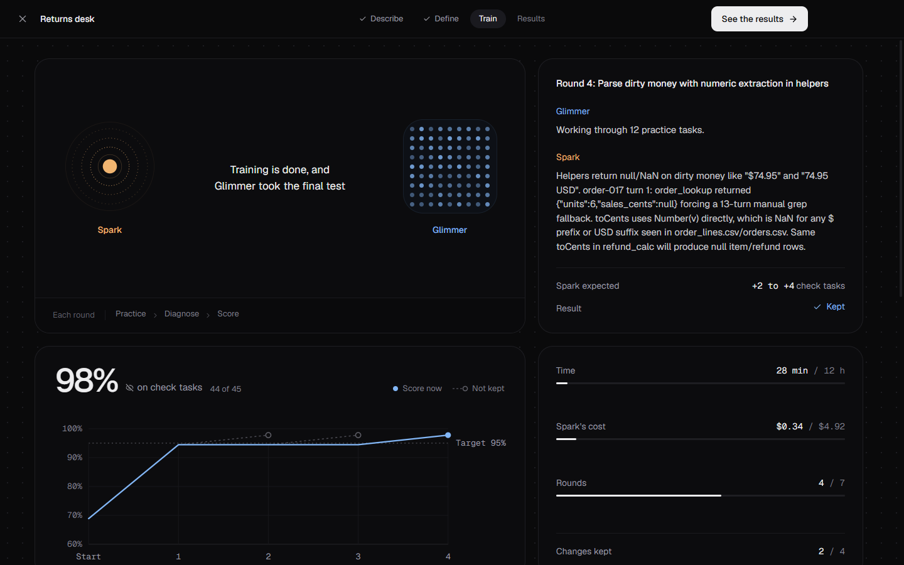
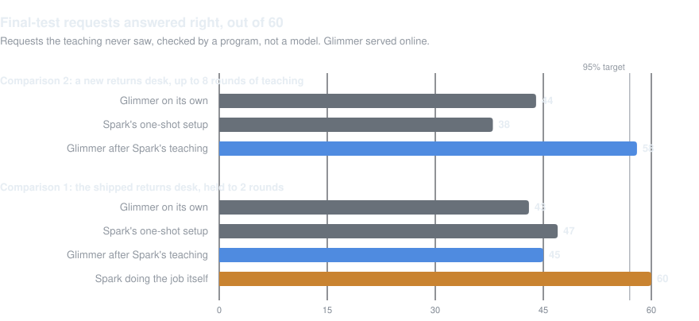

# Architect

Architect turns a job you describe into an AI agent that runs on your own computer. [See it on the website](https://echoo19.github.io/architect/).

You describe the job and attach the files it works from. Muse Spark, a large model, watches Muse Glimmer, a small one that fits on a PC, try the job. When Glimmer gets something wrong, Spark finds the step where it went wrong and changes Glimmer's instructions and tools. A change stays only if Glimmer then does better on check requests Spark never sees. Once Glimmer passes a final test on its own, it's your agent: it works on your files, asks before it changes one, and talks to nothing but the model on your machine.

<picture>
  <source media="(prefers-color-scheme: light)" srcset="docs/comparisons/screens/returns-desk-2-train-light.png">
  
</picture>

## Results

<picture>
  <source media="(prefers-color-scheme: light)" srcset="docs/comparisons/results-light.svg">
  
</picture>

- On a new returns desk, teaching took Glimmer from 44 to 58 of 60 on requests it had never seen. Request by request it fixed 15 and broke 1, so it's 23 points better, with a 95% interval of 11 to 36. The plan was [published before the run](docs/comparisons/returns-desk-2-plan.md).
- Its typical answer dropped from 17.7 seconds to 3.5.
- The teaching cost 42 cents of Spark.
- An earlier run, with teaching held to two rounds, showed no clear gain.

Those numbers come from 1,956 real attempts. Glimmer read 78 million tokens and wrote 2.7 million through OpenRouter ($7.92), and Spark used 4.7 million ($3.06). The full reports are in [docs/comparisons](docs/comparisons).

## Get it

Download it for Windows or macOS from the [latest release](https://github.com/echoo19/architect/releases/latest). You'll need [Ollama](https://ollama.com). The first screens download Glimmer (17 GB, or 14 GB for a 12 GB graphics card) and connect Spark with an API key from Meta. The app isn't signed yet: on Windows choose More info, then Run anyway; on a Mac, right-click it and choose Open.

Then describe a job of your own, try the sample job, or open the returns desk agent from the results above.

## More

- Spark and Glimmer are the defaults, not requirements. The teacher can be a model from OpenAI, Anthropic, Google or OpenRouter, or a local one in Ollama or LM Studio, and the training settings sit under Advanced, including what the teacher may change: instructions, what the agent reads, small tools, its weights, or questions for you. See [docs/MODELS.md](docs/MODELS.md).
- If your files include a policy with prices, discounts or rounding, Architect shows you the rule it made from it, with worked examples, and trains only after you confirm it. On a repair shop's pricing, one round of teaching took Glimmer from 22 of 30 check tasks to 40 of 40 on its final test (a single run, not a planned comparison).
- An agent exports as one file, or publishes to Hugging Face, private by default.
- The `architect` command does the same from a terminal: [docs/CLI.md](docs/CLI.md).
- How it fits together, and why: [docs/ARCHITECTURE.md](docs/ARCHITECTURE.md) and [docs/DECISIONS.md](docs/DECISIONS.md).

## Built during the Meta Global AI Developer Hackathon

Built from an empty repository between Oct 27 and Nov 4, 2026, by Jake Kang with Claude Code, with GPT-6 Astra and GPT-6 Sol for second opinions and code reviews. The idea came first; every line of code was written during the event. [docs/HACKATHON.md](docs/HACKATHON.md) has the details.

MIT licence.
