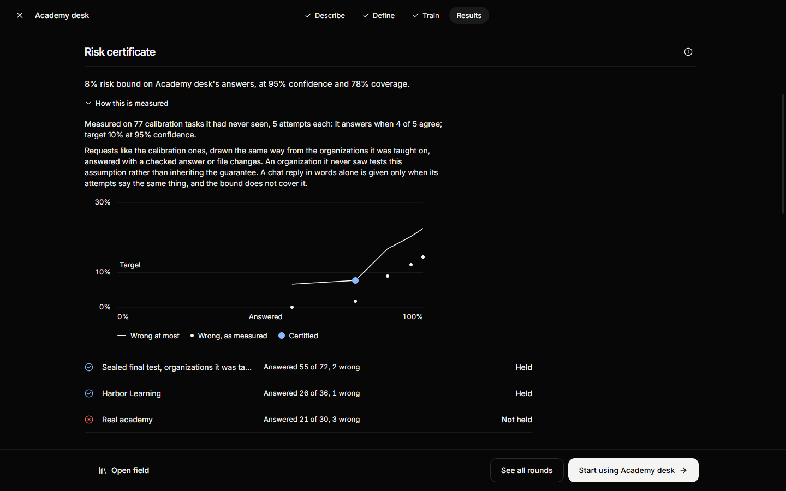
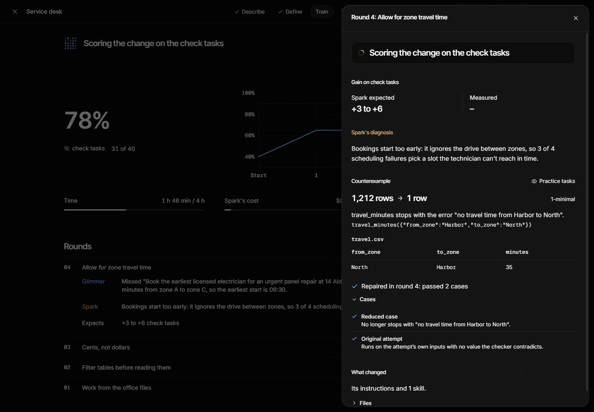
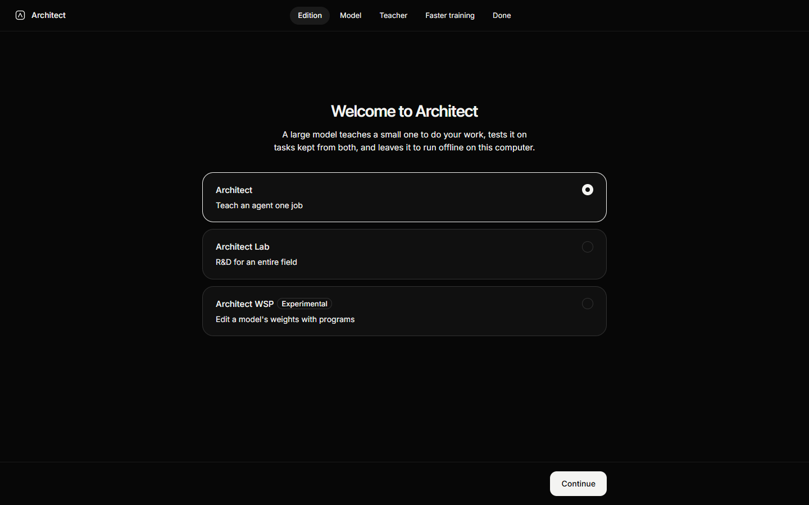
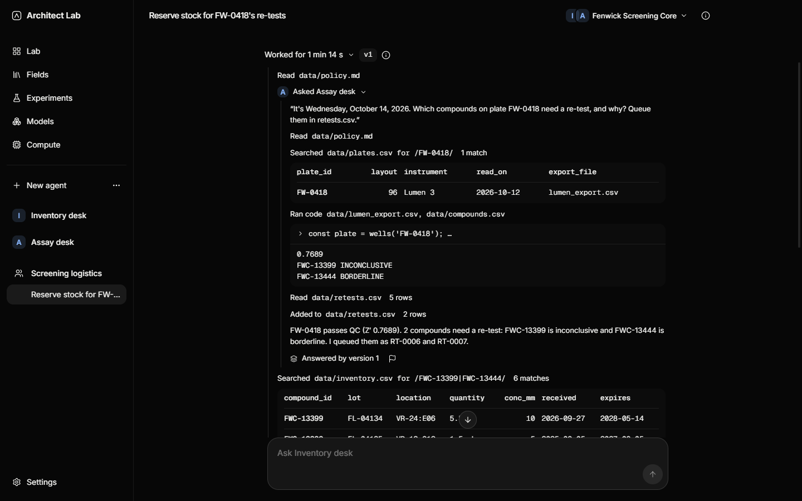
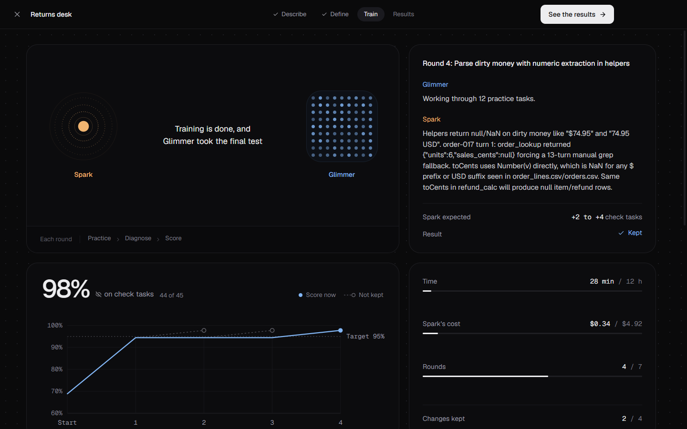
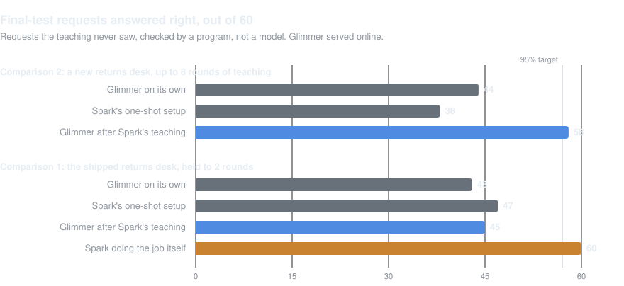
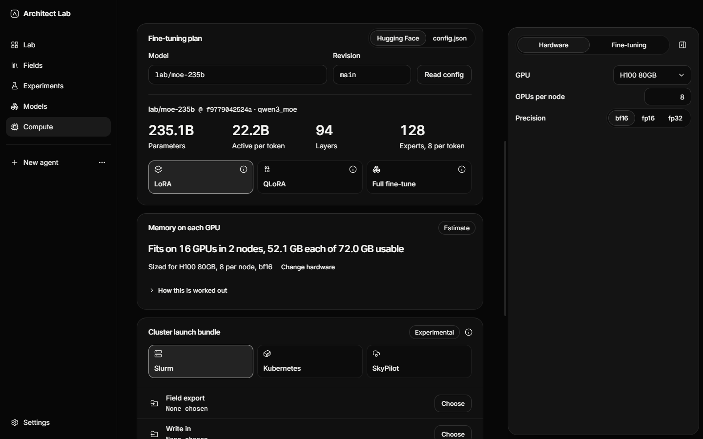

# Architect

**The training system for your own AI.**

Architect is an R&D platform for specialist models. A frontier model, Muse Spark, trains a small one, Muse Glimmer, on an organization's own work: it engineers Glimmer's harness (its prompts, tools and lessons), and when the harness isn't enough it fine-tunes Glimmer's weights with LoRA or QLoRA. Every refinement is a hypothesis tested on held-out checks Spark never sees, and the result is judged once, on a sealed final test that includes organizations neither model has seen. The specialist that comes out runs on-premise and offline, and it can carry a risk certificate that bounds how often it is wrong. [See it on the website](https://echoo19.github.io/architect/).

## Why we made this

Most teams that build with AI rent it, and every request sends their data to someone else's model. Architect works the other way round: a large model teaches a small one the work and then leaves. What's left runs on the team's own computer and comes with a record of what it can and can't do.

We started building Architect on October 27, 2026. Y Combinator's Requests for Startups for Winter 2027 came out after that, and three of them ask for what we were already making: [Own Your Intelligence](https://www.ycombinator.com/rfs#own-your-intelligence) (Jon Xu), [AI for the Air-Gapped Economy](https://www.ycombinator.com/rfs#ai-for-the-air-gapped-economy) (Brad Flora) and [Vertical Foundation Models](https://www.ycombinator.com/rfs#vertical-foundation-models) (Diana Hu). [The website](https://echoo19.github.io/architect/#why) quotes each one next to what Architect does about it.

## What you can make with it

The specialists are what the system makes. They are examples, not the product.

- **Returns desk** works an outdoor-gear shop's returns: it decides return requests, answers questions about orders and books carrier pickups. It asks before it changes a record.
- **Service desk** does a home-services company's end-of-day office work: it prices finished jobs into invoices, works out overdue balances and books technicians.
- **Academy desk** helps the staff of test-prep academies: it diagnoses a missed practice question, sets practice in the academy's records and flags the student for their tutor. It is the main example below.
- **A pricing desk** that a large model drafted from a repair shop's files, after the owner confirmed the pricing rule it made from the shop's policy.
- **Assay desk, Inventory desk and Sweep desk** are the science set: Assay desk reads a screening lab's plate-reader exports, Inventory desk reserves compound stock for the re-tests Assay desk queues, and Sweep desk reads a research group's training sweeps.

Academy desk answers from each academy's own files: its topics, question bank, lessons, the student's history and its tutoring policy. Two academies with different policies get different correct actions from the same Academy desk.

## How it works

- **A field, not a prompt.** You describe a kind of work done across several organizations, such as test-prep academies or screening labs, each with its own files and policy. Spark studies all of it (recordings too, through Muse Voice Transcribe) and writes a brief where every rule is traced to its source. You confirm it.
- **Harness engineering.** Spark drafts the harness, then reads Glimmer's failed attempts, finds the step that went wrong, and refines it. A refinement stays only if it beats the held-out checks; otherwise it is rolled back. Every change is logged with the failure that caused it, the predicted effect and the measured one.
- **Counterexample-guided repair.** When a tool Spark wrote gives a wrong result, Architect shrinks the failing case, Spark fixes the tool against it, and the case joins the field's regression suite.
- **Fine-tuning.** Architect exports checker-verified training data, sizes a LoRA, QLoRA or full fine-tune from the model's own config, trains on Hugging Face Jobs, and writes launch bundles for Slurm, Kubernetes and SkyPilot clusters.
- **A sealed final test.** Some organizations are kept away from both models. The final test runs once, after everything is frozen, and a program scores it for each skill at each organization, never the wording.
- **Risk certificates.** A sealed calibration set decides when the specialist answers and when it hands off to a person, with a stated bound and confidence, and the bound is then checked on organizations it never trained on.
- **Agent teams.** Specialists work together: a lead asks a teammate when the answer is in the teammate's files. Each still reads only its own files and asks before it writes.

The result is a specialist that works on an organization's files, asks before it changes one, and talks to nothing but the model on your machine. The same steps work on a single job, like the returns desk below.

## Certified answers

A specialist should know when not to answer. After qualification, Architect can state a certificate that a buyer can read:

> When Academy desk answers, it is wrong on at most 5% of requests like these, with 95% confidence. It handed 0% to a person.
> Harborview Prep: answered 53 of 54, 0 wrong. Held.

That is the first certificate Architect issued, on a live model. Its numbers are under [Results](#the-first-risk-certificate).

How it is computed:

1. **A sealed calibration set.** It is drawn from the taught organizations, kept apart from every other split, and the teacher never sees it. It opens once, after the specialist is frozen.
2. **Agreement.** Academy desk attempts each calibration request k times (five by default). The share of attempts that agree with the most common answer is its agreement. When agreement reaches a threshold, Academy desk answers. Below it, Academy desk says it isn't sure and hands the request to a person.
3. **A bound.** For each threshold, the error rate among the requests Academy desk answered gets an exact one-sided Clopper-Pearson upper bound. Thresholds are tried from strictest to loosest, and the loosest one whose bound stays under the target is chosen. If none qualifies, no certificate is issued, and the report says why.
4. **A check on organizations it never saw.** The same frozen threshold runs on the sealed test and on each unseen organization, and the report shows whether the bound held there. The guarantee assumes requests like the calibration ones, so an unseen organization tests that assumption.

A small calibration set gives a wide bound, and the report shows it wide.

## Counterexample-guided repair

When a helper that Spark wrote gives a wrong result on practice data, Architect shrinks the failing case until little is left. On a generated academy's practice data, a question lookup that crashed on tests laid out as "Full" went from 2,312 rows to 4. Spark repairs the helper against that small case, the repair must also pass the original case and every earlier one, and the case stays in the field's regression suite so a later change can't break the helper again.

What this shows is a reproducible defect in a helper, not why the model reasoned as it did.

Both are built and tested, with stand-in models and on the academy's practice data, and the certificate has now run live twice. The screenshots above use stand-in data. The first live run withheld its certificate from the third field run's Academy desk, which gave the same wrong answer five times out of five ([below](#a-first-live-certificate)); the second issued one to the first run's Academy desk. Neither idea is new. We build on conformal risk control ([arXiv 2208.02814](https://arxiv.org/abs/2208.02814)), Learn-then-Test ([arXiv 2110.01052](https://arxiv.org/abs/2110.01052)), conformal abstention ([arXiv 2405.01563](https://arxiv.org/abs/2405.01563)) and delta debugging (Zeller and Hildebrandt, 2002). What is new here is the pipeline in a product: a deterministic checker, sealed sets the teacher never saw, and a check on organizations it never saw. The plan is [docs/CERTIFY.md](docs/CERTIFY.md).

## Two editions

Architect is one app in two editions. You choose one on the first screen and can switch in Settings. One download includes both.

- **Architect** teaches an agent one job. You describe the job, Spark teaches Glimmer, a sealed test checks it, and the agent runs offline. The returns desk below is this edition.
- **Architect Lab** is a workbench for founders and researchers who build models for a field. It adds fields, with the organizations a model is taught on and the ones it never sees; experiments that are preregistered before they run; a registry of every model version with its scores; and compute plans for training.

## Teams

In Architect Lab, specialists can work as a team. You pick a lead and up to three teammates. When a request needs another desk's work, the lead asks that teammate. The teammate works in its own folder on what it was asked, and only its answer comes back. Each agent still asks before it changes a file, and the question names the agent that wants to. In the science set, Inventory desk asks Assay desk which compounds on a plate need a re-test, then reserves stock for exactly those. The lead is told which files each teammate holds, and to ask first when a request names something its own files lack. A team isn't certified as a team.

## Results

Every number below comes from a real run, with the plan written before it started, and from the reports in [docs/comparisons](docs/comparisons). The organizations are generated, except the anonymized real academy. "Unseen" means sealed away from both models until the final test.

| Run | Where | Glimmer alone | Taught |
| --- | --- | --- | --- |
| Inventory desk | Corvid Hill Discovery, an unseen lab | 4 of 32 | 27 of 32 |
| Academy desk | Harborview Prep, an unseen academy | 24 of 48 | 43 of 48 |
| Assay desk, two seeds | Corvid Hill Discovery, an unseen lab | 5 and 8 of 48 | 14 and 16 of 48 |
| Returns desk, taught by Spark Open | sealed final test | 18 of 60 | 39 of 60 |
| Returns desk | sealed final test | 44 of 60 | 58 of 60 |

The first risk certificate and the first QLoRA fine-tune follow the academy runs below.

### Inventory desk at a lab it never saw

Inventory desk runs a screening lab's compound store: how much of a compound is usable, which lot a re-test comes from, and holds on that stock. Spark studied three generated labs and taught Glimmer on them. At Corvid Hill Discovery, a fourth lab sealed away from both models, with its own volumes, expiry rule and draw order, Inventory desk passed 27 of 32 tasks, against 4 for Glimmer alone.

| Passed, out of tasks | Glimmer alone | Spark's one-shot harness | Inventory desk |
| --- | --- | --- | --- |
| Taught labs (24) | 3 | 14 | 21 |
| Corvid Hill Discovery, unseen (32) | 4 | 28 | 27 |
| All (56) | 7 | 42 | 48 |

- Task by task at Corvid Hill, Inventory desk won 24 and lost 1: +71.9 points, with a 95% interval of +48.4 to +84.0. It gained on all four skills.
- Spark's first harness carried the gain. It is one stock-planning tool that takes every lab's numbers from that lab's own policy, so it holds none of the taught labs' numbers and transfers as written. The two refinements added two lines about tool-call format: level with the first harness at Corvid Hill (-3.1 points, -20.9 to +14.7) and +29.2 points on the taught labs (+0.2 to +52.6).
- The run cost $1.38 of hosted Glimmer and at most about $0.54 of Spark.

Limits: hosted Glimmer under one seed, four generated labs, and whole configurations compared (Glimmer alone at temperature 1 with 16 turns, the harnesses at temperature 0 with 30). The report is [docs/comparisons/inventory-desk-1.md](docs/comparisons/inventory-desk-1.md).

### Assay desk, under two seeds

Assay desk reads a screening lab's plate-reader exports: inhibition, plate QC, hits, replicates and the re-test queue. In its second run, at the sealed lab Corvid Hill Discovery, it passed 14 of 48 under one seed and 16 of 48 under a second, against 5 and 8 for Glimmer alone.

| Passed, out of tasks | Seed | Glimmer alone | Assay desk |
| --- | --- | --- | --- |
| Corvid Hill Discovery, unseen (48) | 101 | 5 | 14 |
| | 102 | 8 | 16 |
| All (84) | 101 | 10 | 25 |
| | 102 | 12 | 26 |

- At Corvid Hill the difference was +18.8 points (+2.2 to +34.3) under seed 101 and +16.7 (+3.8 to +29.3) under seed 102. Both intervals are above zero.
- Assay desk passes largely the same tasks under both seeds (22 tasks passed both times). Glimmer alone, at temperature 1, passed only 1 task both times.
- The gain is Spark's first harness, with a plate tool that computes the controls, Z' and each well's inhibition. Its one refinement was stopped before it was measured: the counterexample check found that the new tool gave a plate's Z' as 0.8209 where the checker expects 0.8062.
- Pass rates stay near 30% because the plate tool returns every well, and on larger plates that overflows Glimmer's 16,384-token context. About a third of the final-test misses stopped on an error, most likely this one, and the refinement the check stopped was aimed at it.

Limits: generated labs only; it reuses the first run's tasks and seed 101; one development, tested under two seeds. The reports are [docs/comparisons/assay-desk-2.md](docs/comparisons/assay-desk-2.md) and the first run's [assay-desk-1.md](docs/comparisons/assay-desk-1.md).

### An open-weight teacher: Spark Open through Baseten

With Muse Spark Open as the teacher, served by Baseten, both models in the pipeline have open weights. On the returns desk's sealed final test, its harness took Glimmer from 18 to 39 of 60 requests.

| Glimmer | Final test, of 60 | Refunds | Order questions | Pickups |
| --- | --- | --- | --- | --- |
| On its own | 18 | 7 | 6 | 5 |
| Spark Open's one-shot harness | 31 | 13 | 7 | 11 |
| Taught by Spark Open | 39 | 14 | 10 | 15 |

- Request by request, teaching won 28 and lost 7: +35.0 points, with a 95% interval of +16.8 to +50.2. Its one refinement won 8 requests over the first harness and lost none.
- Spark Open cost $0.19 for 4 calls, and hosted Glimmer $3.13.
- Glimmer on its own passed 18 here and 44 in the earlier Spark run on the same tasks. This engine refuses a turn that no longer fits the 16,384-token context of the build on your computer, and 12 of its 60 final attempts ended that way, so the 18 is a lower baseline than the 44.

Limits: 2 rounds of teaching of the 3 planned, because the arm's Glimmer cap stopped it; one seed; hosted Glimmer. The report is [docs/comparisons/returns-desk-open-1.md](docs/comparisons/returns-desk-open-1.md).

### Academy desk, tested across academies

Academy desk is Glimmer with the instructions and tools Spark built for it. Spark studied three generated academies and taught Glimmer on them. The sealed test had 120 tasks: 48 held out from those three academies, 48 from Harborview Prep, a fourth generated academy with numbers in its policy that no taught academy has, and 24 from a real academy, anonymized, whose records are not published. Neither model had seen the last two. On the real academy only three skills could be checked, because its records have no question text.

| Passed, out of tasks | Glimmer on a blank setup | Spark's one-shot setup | Academy desk |
| --- | --- | --- | --- |
| Taught academies (48) | 21 | 22 | 44 |
| Harborview Prep, unseen (48) | 24 | 22 | 43 |
| Real academy, unseen (24) | 9 | 11 | 12 |

- On Harborview Prep, Academy desk passed 43 of 48 and a blank setup 24. Task by task, Academy desk won 20 and lost 1, a difference of 39.6 points with a 95% interval of 22.9 to 53.7. A gain is shown on that one academy.
- On the real academy, Academy desk passed 12 of 24 and a blank setup 9. The difference is 12.5 points with an interval of -17.9 to 40.2; 24 tasks are too few to confirm that gain yet.
- By skill on the real academy, assign went from 0 of 8 to 7 of 8, history fell from 5 to 3 and diagnose from 4 to 2. Eight tasks per skill is too few to call these differences.
- The misses came from tools built on the generated academies. The question lookup tool found a test by its section, and 11 of the real academy's 19 practice tests list the section as "Full". The history helper counted answers written another way as wrong, and the agent's date did not match the date in the requests. We found this by replaying Academy desk's tools against the real academy's files after the test was retired. The date cause fits the records and is not confirmed.
- The one-shot setup was level with a blank setup in every group, so the gain came from the teaching rounds.
- Teaching took three rounds, about 15 minutes. Two changes were kept and one was reverted. The run cost about $0.58 of Spark and $4.26 of hosted Glimmer.

Limits: the numbers come from full-precision Glimmer hosted through OpenRouter, under one seed, and the build that runs on your computer was measured afterward, as the next section shows. The real academy gave 24 tasks from 16 students, and its policy was drafted for this test and awaits the academy's confirmation. A script confirmed the study, not a person. The settings differ by arm: the blank setup ran at temperature 1 with 16 turns, and the other two at temperature 0 with 30 turns. The full report is [docs/comparisons/academy-desk-1.md](docs/comparisons/academy-desk-1.md).

### Academy desk on this computer

Academy desk was then frozen as it was and took the same 120 tasks again on the 2-bit build of Glimmer that runs on an RTX 4070 Ti with 12 GB, through Ollama. Nothing was taught or tuned for this check, and the test had already been opened.

| Passed, out of tasks | Academy desk, local | Academy desk, hosted |
| --- | --- | --- |
| Taught academies (48) | 45 | 44 |
| Harborview Prep, unseen (48) | 41 | 43 |
| Real academy, unseen (24) | 17 | 12 |
| All (120) | 103 | 99 |

- Over all 120 tasks the difference is +3.3 points with a 95% interval of -4.3 to +11.0. No group shows a difference.
- A typical task took 38 seconds locally and 9 hosted, about four times as long. Eleven tasks hit the step limit locally and seven hosted.
- The untaught Glimmer did not finish on the Real academy locally: that run stopped after 2 of 24 tasks when the system ran low on memory. So this does not show how the build does without Academy desk's setup. It is one seed. The report is [docs/comparisons/academy-desk-1-local.md](docs/comparisons/academy-desk-1-local.md).

### The third field run

A second field run stopped twice before any result was read: first its budget ran out, then the runner opened two final tests at once. The third run replaced it, on the same 126 tasks. Spark studied three other generated academies and taught Glimmer on them over two rounds, and both changes were kept. The sealed test had 48 held-out tasks from those academies, 48 from Juniper Study House, a generated academy neither model had seen, and 30 from a second anonymized snapshot of the real academy, from 17 students. Spark's one-shot setup was developed but its final test was held back and never run, so two setups took it.

| Passed, out of tasks | Glimmer on a blank setup | Academy desk |
| --- | --- | --- |
| Taught academies (48) | 15 | 24 |
| Juniper Study House, unseen (48) | 15 | 31 |
| Real academy, unseen (30) | 13 | 3 |
| All (126) | 43 | 58 |

- On Juniper Study House, Academy desk passed 31 of 48 and a blank setup 15. Task by task it won 18 and lost 2, a difference of +33.3 points with a 95% interval of +16.2 to +47.5. That is a gain, and it came from assign, history and hint.
- On the taught academies the difference was +18.8 points, with an interval of +2.0 to +33.9.
- On the Real academy, Academy desk passed 3 of 30 and a blank setup 13, a difference of -33.3 points (-50.3 to -14.2), on history and diagnose.
- Why, from replaying Academy desk's own tools on the Real academy's files and checking its rules against the requests' wording, offline and after the test: its diagnose instructions load on phrases like "what topic", and the Real academy asks "Which topic was that, and what was the right answer?", so they never loaded. Its history tool gives the right result on all 10 tasks, but every attempt ran to the 30-step limit. The likely cause is that the instructions ask for a number of days the Real academy's policy doesn't have, while the second round allowed one tool call per turn. No replies are kept, so that is not confirmed. Assign was 0 of 10 for both setups, because the Real academy's assignments file is empty and its drafted policy never says how to number the first row. The task builder was fixed afterwards, and this run's numbers stand as measured.
- The run cost $0.44 of Spark and $7.35 of hosted Glimmer. No local GPU was used.

Limits: hosted Glimmer under one seed. The blank setup ran at temperature 1 with 16 turns and low reasoning, Academy desk at temperature 0 with 30 turns and high reasoning, and Academy desk used about three times the blank setup's spend. Without the one-shot setup's result, the run can't say how much of the gain came from the draft and how much from the rounds. A script confirmed the study, not a person. The reports are [docs/comparisons/academy-desk-3.md](docs/comparisons/academy-desk-3.md) and [academy-desk-3-misses.md](docs/comparisons/academy-desk-3-misses.md).

### A first live certificate

The third run's Academy desk, frozen as it was, was then put up for a certificate on hosted Glimmer: 60 calibration tasks from the taught academies that its run never touched, five attempts each, a target of at most 10% wrong among answered requests (ε = 0.10) at 95% confidence (δ = 0.05), and a check on the Real academy's first snapshot with 5 diagnose and 5 history tasks. Assign was left out there, as planned, since no setup could pass those tasks in the third run.

The certificate was withheld, as it should be for this version. Even answering only when all five attempts agreed, Academy desk would have answered 46 of 60 and been wrong on 14, with an upper bound of 43.5% against the 10% target.

| Answers when | Answered, of 60 | Wrong | Handed off | Upper bound | Real academy: answered, wrong, of 10 |
| --- | --- | --- | --- | --- | --- |
| 5 of 5 agree | 46 | 14 | 23% | 43.5% | 8, 8 |
| 4 or more of 5 | 52 | 16 | 13% | 43.0% | 9, 9 |
| 3 or more of 5 | 60 | 21 | 0% | 46.4% | 10, 10 |

- The certificate refused to vouch for a model that was confidently wrong, which is the point of certifying. On the tutoring turn, all 7 tasks it answered with five attempts in agreement were wrong. On solve it answered 15 of 15, all right. At temperature 0 the five attempts differ only by the provider's own variation, so a wrong answer repeats as reliably as a right one.
- On the Real academy it got 0 of 10 right. At full agreement it would have answered 8, all wrong, and handed 2 to staff.
- The run found a flaw. When all five attempts ran out of steps, the five "no answer" results counted as agreement and were graded wrong instead of handed off. That covers all 5 Real academy history tasks and 3 of the 14 calibration errors. It was fixed after this run.
- It cost $4.42 of OpenRouter in 350 attempts, with no Spark and no local GPU.

Limits: one set of seeds on hosted Glimmer, calibration tasks from generated academies, and 10 check tasks on a policy drafted for the test. The report is [docs/comparisons/academy-desk-cert-1.md](docs/comparisons/academy-desk-cert-1.md).

### The first risk certificate

The second live run asked for a certificate on the Academy desk from the first field run, frozen as it was, with nothing taught or tuned for it. It was issued: when Academy desk answers, it is wrong on at most 5% of requests like these, with 95% confidence, and the bound held at Harborview Prep, the academy it never trained on.

| | Tasks | Answered | Wrong | Handed to staff | 95% upper bound |
| --- | --- | --- | --- | --- | --- |
| Calibration, taught academies | 60 | 60 | 0 | 0 | 4.87% |
| Check, Harborview Prep, unseen | 54 | 53 | 0 | 1 | 5.5% |

- Each task was attempted five times. 298 of 300 calibration attempts and 254 of 270 Harborview attempts passed, and taking the most common answer outvoted every one of the 6 wrong single answers.
- The 4.87% is the lowest bound 60 error-free tasks can give, so it is set by the size of the calibration set; more tasks would certify a tighter bound.
- It cost $1.28 of hosted Glimmer for 570 attempts, with no Spark.

Limits: it covers three of Academy desk's six skills (diagnose, history and assign), the ones that can be built from an academy's records; the academies are generated; one seed set at temperature 0. The report is [docs/comparisons/academy-desk-cert-2.md](docs/comparisons/academy-desk-cert-2.md).

### The first QLoRA fine-tune

Architect fine-tuned Glimmer's open weights for the first time, end to end through its own path, on Inventory desk's checker-passed work: 22 practice attempts from the three taught labs, nothing from a sealed lab.

| | |
| --- | --- |
| Method | QLoRA: Glimmer loaded in 4 bits, a LoRA of rank 16 on 312 modules, 2 epochs |
| Hardware | one NVIDIA A100 80 GB on Hugging Face Jobs |
| Time and cost | 8.2 minutes of GPU for $0.34; about $0.98 for the whole run, with the jobs that found and fixed three faults |
| Training loss | 0.106 at the first step, 0.008 at the last |
| Adapter | a 180 MB GGUF LoRA that passes the adapter runtime's checks against the base model |

- The three faults (the image's Python, the planner's memory estimate and the converter's handling of the q and k projections) were each fixed in the product, with a test, before the next job.
- Its effect on Inventory desk's sealed final test is measured next, on a GPU serving the base with the adapter. The low loss says the adapter fits its 22 examples, which are Glimmer's own successes.

The report is [docs/comparisons/qlora-1.md](docs/comparisons/qlora-1.md).

### The returns desk, one job

<picture>
  <source media="(prefers-color-scheme: light)" srcset="docs/comparisons/screens/returns-desk-2-train-light.png">
  
</picture>

This run came before Academy desk's. It is the simpler case: one job and one business's files.

<picture>
  <source media="(prefers-color-scheme: light)" srcset="docs/comparisons/results-light.svg">
  
</picture>

- On a new returns desk, teaching took Glimmer from 44 to 58 of 60 on requests it had never seen. Request by request it fixed 15 and broke 1, so it's 23 points better, with a 95% interval of 11 to 36. The plan was [published before the run](docs/comparisons/returns-desk-2-plan.md).
- Its typical answer dropped from 17.7 seconds to 3.5.
- The teaching cost 42 cents of Spark.
- A run before it, with teaching held to two rounds, went from 43 to 45 of 60, within its interval.

Those numbers were measured on full-precision Glimmer, hosted through OpenRouter. The gain came from changes to Glimmer's instructions and tools; no weights were trained. The smaller 4-bit build that runs on your computer has not been measured on this test. The numbers come from 1,956 real attempts. Glimmer read 78 million tokens and wrote 2.7 million through OpenRouter ($7.92), and Spark used 4.7 million ($3.06). The full reports are in [docs/comparisons](docs/comparisons).

### Limits of these runs

Each run above lists its own limits. Across them, the numbers are hosted Glimmer, mostly under one seed, and the organizations are generated except the anonymized real academy. Two more runs are in their reports:

- **Agent teams.** In the first live team run the lead asked its teammate in 2 of 20 replies. Told which files each teammate holds, it asked in 18 of 20 in the second, but no answer carried the plate's list: Assay desk's plate tool overflows Glimmer's context on these plates. Both runs passed 0 of 20, team and alone ([team-1.md](docs/comparisons/team-1.md), [team-2.md](docs/comparisons/team-2.md)).
- **Sweep desk.** Spark's first harness passed 23 of 48 at Fennick Research, the unseen group, against 15 for Glimmer alone; its refinement round stopped at the Spark cap, so what refinement adds there is unmeasured ([sweep-desk-2.md](docs/comparisons/sweep-desk-2.md)).

## From a specialist to a field model

Each field Architect works on leaves behind three things besides the specialist:

- **Verified demonstrations.** Worked examples from train tasks that the checker confirmed, as chat-format files, each with its source and what it may be used for. Nothing comes from a sealed organization.
- **An outcome scorer.** The field's train tasks and checker, packaged so an outside training framework can ask for a score: one request in, one score out. Fields whose results can be checked suit this best.
- **Sealed evaluations.** Organizations a model never trained on, opened once for a frozen candidate.

From a chosen model's own configuration on Hugging Face, Architect also sizes a training job: the memory for weights, gradients, optimizer state and activations, then the GPUs and nodes, with the arithmetic shown as an estimate. For a Slurm cluster or Kubernetes it writes an experimental launch bundle and the command to submit it with your own tools. Architect never holds cluster credentials.

Architect develops and evaluates field-specific agent harnesses and exports checker-verified training data. The single-GPU path has run for real: the QLoRA fine-tune above trained an adapter on one A100, and its effect on the sealed test is measured next. The experimental cluster templates are validated structurally and against simulated schedulers; running them on a real cluster and with large models is still ahead. What the results measure today is the harness. A model trained on a whole field is the direction. The plan is [docs/SCALE.md](docs/SCALE.md).

## Where it fits

Y Combinator's [Requests for Startups for Winter 2027](https://www.ycombinator.com/rfs) asks for vertical models: specialized ones "matching or beating general-purpose models at orders of magnitude less inference compute". It names the hard part as high-quality rewards that are specific to the field and can be verified. This is our reading of that request, and Architect does not claim to meet it. We see it as a small step in that direction. The idea is direction, not result: if the same loop ran over many organizations of one field, it would produce verified curricula and checkable rewards, and field-specific models need both. Academy desk shows one field in two runs: six taught academies, two unseen generated academies and two snapshots of one real academy, with 24 and 30 tasks. That is a first step, and the second snapshot, where Academy desk passed 3 of 30 with rules and tools built on generated files, shows how much a real organization adds. What Architect does today is turn one organization's own records and policy into tasks with exact answers, and a large model teaches a small one until it passes them on its own, on the organization's own computer. For people building vertical models, it's a way to find out whether a small model can do the work, and to make it better at it.

## Related work

Improving an agent from its failures already has published work, such as GEPA ([arXiv 2507.19457](https://arxiv.org/abs/2507.19457)) and ACE ([arXiv 2510.04618](https://arxiv.org/abs/2510.04618)). Checking an agent's work by the state it leaves behind has precedent too, in tau-bench ([arXiv 2406.12045](https://arxiv.org/abs/2406.12045)). Architect puts these ideas into one product you can inspect. It has a sealed final test, a checker that is the same every time, and a result that runs offline.

## Get it

Download it for Windows or macOS from the [website](https://echoo19.github.io/architect/download/) or the [latest release](https://github.com/echoo19/architect/releases/latest). One download includes both editions. You'll need [Ollama](https://ollama.com). The first screens download Glimmer (17 GB, or 14 GB for a 12 GB graphics card) and connect Spark with an API key from Meta. The Mac app is signed and notarized by Apple. The Windows installer isn't signed yet, so the first time Windows warns you: choose More info, then Run anyway.

Then describe a job of your own, try the sample job, or open the returns desk agent from the results above. [The user guide](docs/Architect-Guide.pdf) walks through each step.

## More

- Spark and Glimmer are the defaults, not requirements. The teacher can be a model from OpenAI, Anthropic, Google or OpenRouter, or a local one in Ollama or LM Studio, and the training settings sit under Advanced, including what the teacher may change: instructions, what the agent reads, small tools, its weights, or questions for you. See [docs/MODELS.md](docs/MODELS.md).
- If your files include a policy with prices, discounts or rounding, Architect shows you the rule it made from it, with worked examples, and trains only after you confirm it. On a repair shop's pricing, one round of teaching took Glimmer from 22 of 30 check tasks to 40 of 40 on its final test (a single run, not a planned comparison).
- An agent exports as one file, or publishes to Hugging Face, private by default.
- The `architect` command does the same from a terminal: [docs/CLI.md](docs/CLI.md).
- A job you write yourself is a folder: a job file, its tasks, each organization's files and maybe a checker. The format, with a worked example: [docs/JOB_FORMAT.md](docs/JOB_FORMAT.md). In Architect Lab you can skip writing it: describe the job once and add each organization's folder.
- How it fits together, and why: [docs/ARCHITECTURE.md](docs/ARCHITECTURE.md) and [docs/DECISIONS.md](docs/DECISIONS.md).

## Built during the Meta Global AI Developer Hackathon

Built from an empty repository between Oct 27 and Nov 4, 2026, by Jake Kang with Claude Code, with GPT-6 Astra and GPT-6 Sol for second opinions and code reviews. The idea came first; every line of code was written during the event. [docs/HACKATHON.md](docs/HACKATHON.md) has the details.

MIT licence.
