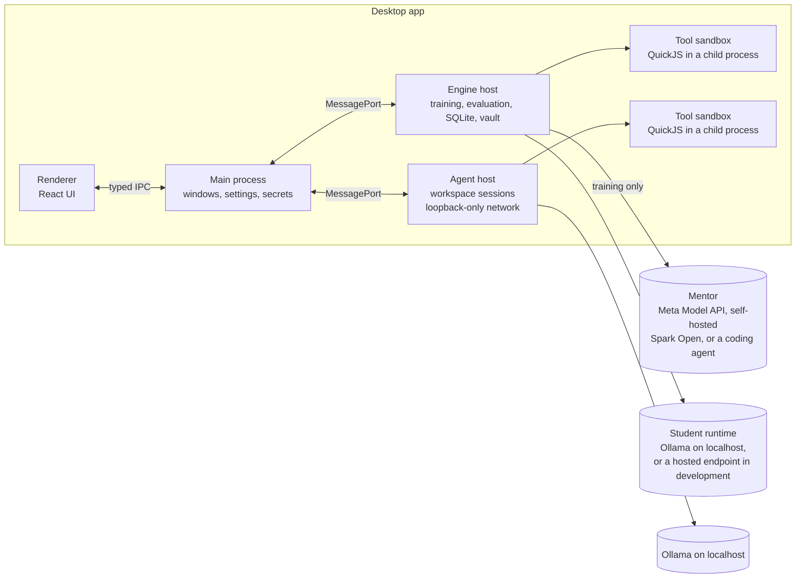

# Architecture

Architect has three engine roles kept apart so the mentor can never grade itself: the **mentor** (diagnoses and edits), the **student** (attempts tasks), and the **runner** (executes attempts, checks them, owns the splits and the budget). The desktop app wraps them in four stages: set up a job, train, read the report card, use the graduate.

## Processes



| Process | Owns | Never does |
| --- | --- | --- |
| Main | Windows, menus, IPC routing, settings, keys (Electron `safeStorage`), Ollama detection and model pulls | Run training or agent logic |
| Renderer | All UI; talks only through the preload bridge (`window.architect`) | Touch Node, the network, or the disk |
| Engine host (utility process) | Jobs, runs, rounds, the core loop, baselines, evaluation, the vault, SQLite, the run event stream | Serve the workspace |
| Agent host (utility process) | Workspace sessions with graduates: opening a graduate's active version from its own folder and this computer's installation, student calls, tool calls, pending writes awaiting approval | Load a mentor adapter or reach a non-loopback host |
| Tool sandbox (child process) | One QuickJS VM per tool call with a data API limited to the job's declared files and permissions, plus time and memory limits | Network, process spawning, or any file the job didn't declare |

The engine and agent hosts are plain Node modules in `packages/engine`. The Electron entry points in `apps/desktop` are thin wrappers, so the whole loop runs under Vitest without Electron.

## The core loop (Architect method)

1. **Setup.** The job file names the data, permissions, tasks, checker, requirements, budget, mentor, student and starting harness. The splitter assigns tasks to train, dev and test by seed, grouped so near-duplicates stay in one split. Test goes straight into the vault.
2. **Attempt.** A run that starts from a blank harness first has its author write a whole draft from the job setup and the train examples, with no attempts, and keeps it as the starting point (decision 026). After that, each round the runner samples a train batch and runs the student on each task inside the current harness version: system prompt, the skills and examples that the retrieval rules select, built-in data tools plus harness tools, decoding settings.
3. **Check.** The checker grades each attempt deterministically: pass or fail with a reason.
4. **Target?** If the dev pass rate meets the requirement, or a budget cap is hit, go to step 7.
5. **Diagnose.** The mentor receives the failing train traces, the harness, per-type train results, the overall dev pass count (never per-type dev counts or dev traces) and the lineage so far, rejected rounds with their reasons included. It returns one hypothesis: a diagnosis, a change set (files to add or edit), the failures it addresses, and a predicted effect on dev. A reply that isn't a usable hypothesis, a change set the harness refuses, or one with a tool whose code doesn't load in the sandbox (decision 025) goes back to the author once with the reason (decision 023); if the fix can't be used either, the round is rejected before dev sees it: the round ends, the mentor is told why the next round, and two rejected rounds in a row end training. Rejections don't use up patience, which counts changes dev measured and reverted.
6. **Keep or revert.** The runner applies the change set to a new harness version and evaluates it on dev, together with the incumbent measured again, under seeds the round draws from the run's panel seed: every dev task once per repeat (`devRepeats`, 1 to 3). If dev passes, added up over the repeats, rise by the job's margin times the repeat count and no task type loses more than its limit times the repeat count, both versions are measured again under the round's next seeds, and the change is kept only if the totals over both measurements clear the limits for twice the runs (decision 022); otherwise it is reverted. Either way a lineage entry records cause, prediction and measured effect, with the first measurement kept beside the totals when there was a second. Back to step 2.
7. **Locked test.** The graduate is frozen (harness version and hash, student pin) and the mentor is released: its gate closes, so no mentor call can start, and the run drops its mentor adapter. Only then does the vault release the test split to the runner, which evaluates the frozen harness once, on the local student by default or on the hosted copy for comparison runs (decision 009). A finished run can be tested once more on the other target (`runs.retest`), with the same frozen harness and no mentor; each target gets its own report card, and nothing about a test ever goes back into training.
8. **Graduate.** The runner writes version 1 of a new agent as a package (decision 036): the frozen harness, the pinned base model, the job contract it was tested against, the report card and a change history. It installs it on this computer with the job's local model endpoint, its own copy of the job's data for `data/`, and the job's write mode, so it is ready to use with no export. It is the agent's active version from the start, and accepting it records that the user took it. Later versions wait as candidates until they are accepted and then promoted (decision 037).

Baselines reuse the same runner, checker, data, budget and seed: **bare** (minimal harness), **one-shot** (the mentor writes a harness from the job setup and train examples without seeing attempts), **self-reflection** (the student edits its own harness over the same rounds).

## Isolation and guarantees

- **Test split.** Only `packages/engine/src/vault` reads or writes it. Mentor payloads are built from an allowlist of fields, and every payload passes a leak check against fingerprints of the test tasks (their prompts, ids and expected results, including the long ids and amounts no other task or data file holds) before it is sent. Tests assert both.
- **Checker.** Deterministic functions; custom checker files run in the sandbox with no clock or randomness. The mentor's change set may only touch harness files; edits outside the harness surface are rejected.
- **Offline graduates.** The agent host installs a guard at startup that refuses any non-loopback connection, and it only constructs local student adapters. A test runs a workspace session against a local fake model server and fails on any other connection attempt.
- **Budgets.** Rounds, mentor dollars and wall clock are checked before every mentor call and every round; a call that would cross a cap does not start. Every training attempt runs under the wall-clock deadline: one still running when the time is up is cut there, not scored, and the run goes to its locked test.
- **Packages.** An import is unpacked and checked in a staging folder (entry names and types, sizes, the manifest's format, every checksum, the runtimes it needs) before anything in it runs, and its harness is parsed against its hash before its tools first load in the sandbox. A version opens only while its manifest and every file still match what was installed, so its harness and adapter can't drift apart. A package asks for access; only the user grants it.
- **Restart.** Runs persist every step to SQLite. On launch the engine host marks interrupted runs and resumes them from the last completed step.

## Data on disk

App data lives in Electron's `userData` folder (`%APPDATA%\Architect`, `~/Library/Application Support/Architect`).

```
architect.db                       jobs and their contract versions, runs, rounds, attempts, costs,
                                   graduates with their versions and installations, chats
jobs/<job>/job.json                the job file (export and import as-is)
jobs/<job>/data/                   snapshot of the job's data files
jobs/<job>/tasks/train.jsonl       mentor-visible splits
jobs/<job>/tasks/dev.jsonl
jobs/<job>/runs/<run>/harness/v<n>/   every harness version, full folder
jobs/<job>/runs/<run>/traces/         attempt traces
jobs/<job>/runs/<run>/mentor/         what the mentor saw and returned, per round
vault/<job>/test.jsonl             locked test split (runner only)
graduates/<graduate>/versions/v<n>/   one version of a graduate: a package (HARNESS_FORMAT.md)
workspace/<graduate>/              the graduate's own copy of its job's data, bound to data/
outputs/<graduate>/                bound to output/
staging/                           where imports and exports are unpacked and checked
```

## Packages

| Package | Contents |
| --- | --- |
| `@architect/shared` | zod schemas and types for every contract below, model registry defaults, run events |
| `@architect/harness` | harness folders (read, write, validate, diff, version) and graduate packages (write, read, check, ZIP, export scan) |
| `@architect/adapters` | `MentorAdapter` and `StudentAdapter` implementations: OpenAI-compatible base, Meta Model API, self-hosted Spark Open, Ollama |
| `@architect/engine` | splitter and vault, checkers, agent loop, tool host, core loop, baselines, budgets, lineage, storage, engine and agent hosts |
| `@architect/ui` | tokens, theme, components |
| `@architect/desktop` | Electron main, preload and renderer |
| `examples/home-services` | sample job: seeded data generator, task generator, checker |
| `examples/gear-returns` | second sample job (decision 028): a returns desk whose exports are messier than their first rows |
